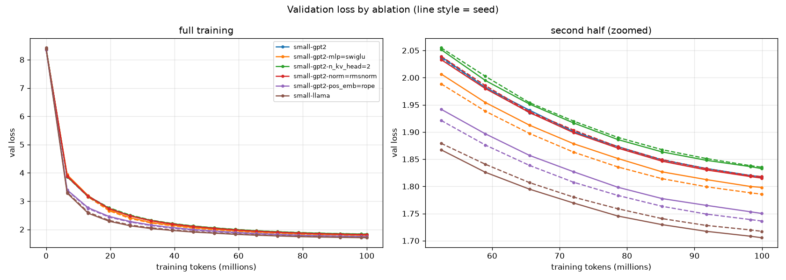

# TinyLLaMA from scratch

A small LLaMA-style language model built from scratch: pretrained, instruction-tuned, and served through a fast inference engine.

> 🚧 Work in progress

## The three parts

| Part | What | Status |
|---|---|---|
| 1. Pretrain | LLaMA architecture (RoPE, RMSNorm, SwiGLU, GQA) + custom BPE tokenizer, trained on TinyStories, with controlled ablations | ✅ |
| 2. Instruction-tune | SFT so the model follows commands ("write a story about X using words Y, Z") | ✅ |
| 3. Serve fast | KV cache, sampling, continuous batching, streaming FastAPI ✅ · INT8 quantization, speculative decoding, Gradio demo ⏳ | 🔨 |

## Project layout

```
tokenizer/     BPE tokenizer, trained from scratch
data/          dataset download + tokenization scripts (outputs .bin files)
model/         config, layers (RoPE, RMSNorm, SwiGLU, GQA), full model
train/         pretraining and SFT training loops
inference/     generation (KV cache + sampling), continuous batching, quantization, speculative decoding
serve/         FastAPI streaming server, Gradio demo
experiments/   ablations, benchmarks, plots
checkpoints/   saved model weights (not in git)
notebooks/     Kaggle notebooks used for GPU training
```

## Workflow

- **Laptop (CPU):** write code, quick debug runs, inference, benchmarks, serving
- **Kaggle (free GPU):** real training runs
- **GitHub:** moves code between the two

## Setup

Inside WSL (Ubuntu):

```bash
cd /mnt/c/Users/<you>/Desktop/tinyllama
python3 -m venv .venv
source .venv/bin/activate
pip install torch --index-url https://download.pytorch.org/whl/cpu   # CPU-only build
pip install -r requirements.txt
```

On Kaggle, PyTorch with GPU support is already installed.

## Running the ablations on Kaggle

Import `notebooks/kaggle_train.ipynb` into Kaggle (**File → Import Notebook**), set the
accelerator to **GPU T4 x2** and turn **Internet** on, then **Save & Run All (Commit)**.
It clones this repo, tokenizes TinyStories, benchmarks the GPU, and runs every
configuration in [experiments/PROTOCOL.md](experiments/PROTOCOL.md).

The same steps work anywhere with a GPU:

```bash
python -m data.prepare_pretrain                      # tokenize TinyStories
python -m experiments.run_ablations --benchmark      # measure speed, estimate total time
python -m experiments.run_ablations --seeds 1 2      # all runs (finished ones are skipped)
python -m experiments.compare --baseline small-gpt2-s1
python -m experiments.plot
```

## Instruction tuning (Part 2)

```bash
python -m data.prepare_sft                                   # TinyStories-Instruct -> chat-formatted examples
python -m train.sft --init_ckpt checkpoints/small-llama-s1.pt
python -m experiments.eval_instruct --ckpts checkpoints/small-llama-s1.pt checkpoints/sft-small-llama-s1.pt
python -m inference.generate --ckpt checkpoints/sft-small-llama-s1.pt --chat \
       --prompt "Write a story. Use the words: rain, ball, happy."
```

The chat template lives in one place ([tokenizer/chat.py](tokenizer/chat.py)) and is shared by data
prep, training and inference. The loss is computed on response tokens only. Instruction following is
measured as the share of required words that appear in the story, against a pretrained model's
chance level.

## Generating and serving

```bash
# generate from a checkpoint (streams tokens, prints TTFT and decode speed)
python -m inference.generate --ckpt checkpoints/<run>.pt --prompt "Once upon a time" --top_p 0.9

# HTTP API with Server-Sent Events streaming and continuous batching; docs at http://localhost:8000/docs
python -m serve.api --ckpt checkpoints/<run>.pt --port 8000 --max_batch 8
curl -N -X POST localhost:8000/generate -H "Content-Type: application/json" \
     -d '{"prompt": "Once upon a time", "stream": true}'

# batching benchmark: the same requests with max_batch 1 (no batching) vs 2..16
python -m inference.bench_batching             # all requests at once
python -m inference.bench_batching --rate 4    # Poisson arrivals, 4 requests/s
```

### Continuous batching

The server decodes up to `--max_batch` requests in one forward pass
([inference/batching.py](inference/batching.py)). Each running request owns one row of a shared
KV-cache tensor; the model takes a separate position per row, so the requests in a batch can be
at different points in their sequences. Every step admits waiting requests into free rows and
retires finished ones, so short replies never wait for long ones. Batched requests produce
exactly the tokens they would produce alone; `tests/test_batching.py` checks this token by token.

32 requests (32–160 new tokens each), 11M-parameter model, laptop CPU (Snapdragon X, 8 threads):

| arrivals | max_batch | throughput | mean time to first token | p95 latency |
|---|---|---|---|---|
| all at once | 1 (no batching) | 133 tok/s | 10.6 s | 21.7 s |
| all at once | 8 | 598 tok/s (4.5×) | 1.8 s | 5.0 s |
| all at once | 16 | 668 tok/s (5.0×) | 1.0 s | 4.5 s |
| 4 req/s (Poisson) | 1 (no batching) | falls behind | 5.2 s | 9.3 s |
| 4 req/s (Poisson) | 4 | keeps up | 65 ms | 1.1 s |

One decode step costs 5.4 ms for 1 row and 16.5 ms for 16 rows: 16× the tokens for about 3× the time.

## Results

### Part 1: which LLaMA changes matter?

GPT-2 baseline vs each LLaMA change on its own vs all of them together. Every run used the same data,
data order, tokenizer, 100M-token budget, optimizer and learning-rate schedule, evaluation windows and
precision ([experiments/PROTOCOL.md](experiments/PROTOCOL.md)). Small size: 6 layers, 384 dims, 512-token
context. Trained on Kaggle T4 GPUs. **Two seeds per configuration**, reported as mean ± std
(the seed changes the initialization; the data order is fixed).

| change vs GPT-2 baseline | params | val loss | val bits/byte | Δ loss (seed 1 / seed 2) | reaches baseline's final loss at | train tok/s |
|---|---|---|---|---|---|---|
| baseline (learned positions, LayerNorm, GELU, multi-head attention) | 12.39M | 1.8322 ± 0.0010 | 0.6488 | — | 100M tokens | 24,952 |
| RoPE | 12.19M | 1.7536 ± 0.0120 | 0.6209 | **−0.079** (−0.071 / −0.086) | 72M (1.39×) | 22,331 |
| SwiGLU (same params) | 12.39M | 1.8062 ± 0.0090 | 0.6396 | −0.026 (−0.020 / −0.032) | 87M (1.15×) | 23,010 |
| RMSNorm | 12.39M | 1.8322 ± 0.0014 | 0.6488 | 0.000 (−0.002 / +0.002) | ~100M (no gain) | 23,826 |
| GQA, 2 KV heads | 11.21M | 1.8480 ± 0.0017 | 0.6544 | +0.016 (+0.014 / +0.018) | not reached | 26,209 |
| **all four = mini-LLaMA** | **11.02M** | **1.7254 ± 0.0065** | **0.6110** | **−0.107** (−0.112 / −0.101) | **62M (1.61×)** | 22,451 |



*Solid and dashed lines are the two seeds.*

- **RoPE is the biggest single win** (−0.079), with 0.2M fewer parameters, since the position table is gone.
- **SwiGLU helps at equal parameter count** (−0.026 on both seeds), but trains about 8% slower per token.
- **RMSNorm changes nothing measurable**: the difference flips sign between seeds. That's expected: it makes
  the norm cheaper, not the model better. Here it's even a little slower, because it's written as plain
  PyTorch ops while LayerNorm has a fused kernel.
- **GQA costs some quality** (+0.016 on both seeds) in exchange for 9.5% fewer parameters, faster training and
  a 3× smaller KV cache. It's an inference trade-off, and it lets more requests fit in a batch.
- **The changes combine better than their sum:** the four single deltas add up to −0.089, the full model
  gets −0.107. With two seeds this is suggestive rather than proven.
- **The mini-LLaMA reaches the baseline's final loss with 62% of the training tokens** (61M and 64M on the
  two seeds). That's measured on the validation curve (evaluated every ~6.5M tokens, linearly interpolated),
  mid-schedule. A run budgeted for 60M tokens would anneal its learning rate and end lower, so 1.61× is a
  conservative figure.

Caveats: two seeds give a rough error bar, not a tight one. Seed-to-seed spread is 0.001 for the baseline
but about 0.01 for RoPE and SwiGLU; every effect except RMSNorm points the same way on both seeds. All runs
trained in bfloat16, which the T4 only emulates. That's slower than float16 but identical across runs, so
the comparison holds.

### Part 2: does instruction tuning work?

The seed-1 mini-LLaMA, fine-tuned for one epoch on 100k TinyStories-Instruct examples (3,125 steps of 32,
lr 1e-4, loss on response tokens only). 8 minutes on one T4 in float16. Validation loss on response tokens
went from 1.729 to 1.434 and was still falling slowly at the end.

Evaluation: 200 held-out instructions, each asking for a story that uses 3 given words (temperature 0.7,
top-p 0.9, up to 300 tokens). The pretrained model gets the instruction as plain text: it has never seen the
chat format, so its score is the chance level, how often the words show up anyway.

| model | required words used | all 3 words used | stopped on its own | mean length |
|---|---|---|---|---|
| pretrained mini-LLaMA (chance level) | 4.0% | 0.0% | 99.0% | 175 tokens |
| **after SFT** | **50.7%** | **13.0%** | 97.5% | 179 tokens |

- **The SFT model reads the instruction:** it uses 12.7× more of the required words than chance.
- **It's partial, not reliable:** only 13% of stories use all three words. An 11M-parameter model trained
  for 8 minutes follows instructions some of the time. Longer training is the obvious next step.

Example (seed 0, CPU):

> **Write a story. Use the words: rain, ball, happy.**
>
> Once upon a time, there was a little girl named Lily. She loved to play in the **rain** and get wet. One day,
> she went outside to play and her feet were very wet. She ran and jumped, feeling so **happy**.
>
> Later that day, Lily and her family went to the park to play. They played on a **ball** and threw it back to
> each other. …
