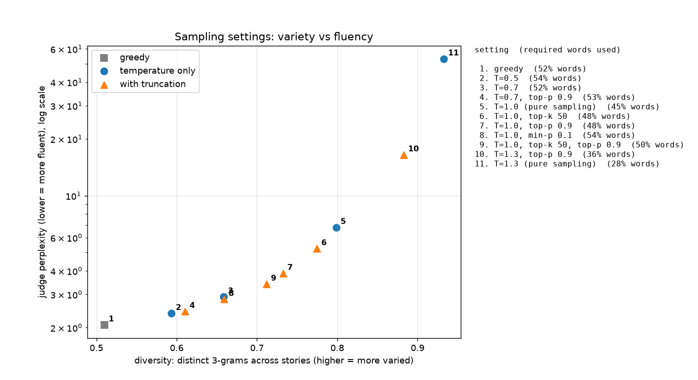

# TinyLLaMA from scratch

A small LLaMA-style language model built from scratch: pretrained, instruction-tuned, and served through a fast inference engine.

> 🚧 Work in progress

## The three parts

| Part | What | Status |
|---|---|---|
| 1. Pretrain | LLaMA architecture (RoPE, RMSNorm, SwiGLU, GQA) + custom BPE tokenizer, trained on TinyStories, with controlled ablations | ✅ |
| 2. Instruction-tune | SFT so the model follows commands ("write a story about X using words Y, Z") | ✅ |
| 3. Serve fast | KV cache, sampling, continuous batching, streaming FastAPI, INT8 quantization, Gradio demo, speculative decoding | ✅ |

## Project layout

```
tokenizer/     BPE tokenizer, trained from scratch
data/          dataset download + tokenization scripts (outputs .bin files)
model/         config, layers (RoPE, RMSNorm, SwiGLU, GQA), full model
train/         pretraining and SFT training loops
inference/     generation (KV cache + sampling), continuous batching, quantization, speculative decoding
serve/         FastAPI streaming server, Gradio demo
experiments/   ablations, benchmarks, plots
checkpoints/   saved model weights (not in git)
notebooks/     Kaggle notebooks used for GPU training
```

## Workflow

- **Laptop (CPU):** write code, quick debug runs, inference, benchmarks, serving
- **Kaggle (free GPU):** real training runs
- **GitHub:** moves code between the two

## Setup

Inside WSL (Ubuntu):

```bash
cd /mnt/c/Users/<you>/Desktop/tinyllama
python3 -m venv .venv
source .venv/bin/activate
pip install torch --index-url https://download.pytorch.org/whl/cpu   # CPU-only build
pip install -r requirements.txt
```

On Kaggle, PyTorch with GPU support is already installed.

## Running the ablations on Kaggle

Import `notebooks/kaggle_train.ipynb` into Kaggle (**File → Import Notebook**), set the
accelerator to **GPU T4 x2** and turn **Internet** on, then **Save & Run All (Commit)**.
It clones this repo, tokenizes TinyStories, benchmarks the GPU, and runs every
configuration in [experiments/PROTOCOL.md](experiments/PROTOCOL.md).

The same steps work anywhere with a GPU:

```bash
python -m data.prepare_pretrain                      # tokenize TinyStories
python -m experiments.run_ablations --benchmark      # measure speed, estimate total time
python -m experiments.run_ablations --seeds 1 2      # all runs (finished ones are skipped)
python -m experiments.compare --baseline small-gpt2-s1
python -m experiments.plot
```

## Instruction tuning (Part 2)

```bash
python -m data.prepare_sft                                   # TinyStories-Instruct -> chat-formatted examples
python -m train.sft --init_ckpt checkpoints/small-llama-s1.pt
python -m experiments.eval_instruct --ckpts checkpoints/small-llama-s1.pt checkpoints/sft-small-llama-s1.pt
python -m inference.generate --ckpt checkpoints/sft-small-llama-s1.pt --chat \
       --prompt "Write a story. Use the words: rain, ball, happy."
```

The chat template lives in one place ([tokenizer/chat.py](tokenizer/chat.py)) and is shared by data
prep, training and inference. The loss is computed on response tokens only. Instruction following is
measured as the share of required words that appear in the story, against a pretrained model's
chance level.

## Generating and serving

```bash
# web demo: type an instruction, watch the story stream in, see which required words it used
python -m inference.quantize --ckpt checkpoints/sft-small-llama-s1.pt    # once: the 11 MB int8 model
python -m serve.demo                                                    # http://127.0.0.1:7860

# generate from a checkpoint (streams tokens, prints TTFT and decode speed)
python -m inference.generate --ckpt checkpoints/<run>.pt --prompt "Once upon a time" --top_p 0.9

# HTTP API with Server-Sent Events streaming and continuous batching; docs at http://localhost:8000/docs
python -m serve.api --ckpt checkpoints/<run>.pt --port 8000 --max_batch 8
curl -N -X POST localhost:8000/generate -H "Content-Type: application/json" \
     -d '{"prompt": "Once upon a time", "stream": true}'

# batching benchmark: the same requests with max_batch 1 (no batching) vs 2..16
python -m inference.bench_batching             # all requests at once
python -m inference.bench_batching --rate 4    # Poisson arrivals, 4 requests/s

# INT8: write an 11 MB int8 checkpoint, or quantize any checkpoint while loading
python -m inference.quantize --ckpt checkpoints/sft-small-llama-s1.pt     # -> sft-small-llama-s1-int8.pt
python -m serve.api --ckpt checkpoints/sft-small-llama-s1-int8.pt
python -m inference.generate --ckpt checkpoints/<run>.pt --quant int8 --prompt "Once upon a time"
python -m inference.bench_quant --ckpt checkpoints/small-llama-s1.pt      # float32 vs int8: size, quality, speed

# speculative decoding: a 2.5M draft model guesses, the real model checks (~40 min to train the draft on CPU)
python -m train.pretrain --size draft --token_budget 24000000 --batch_size 32 --grad_accum 1 \
       --out_dir experiments/results_draft --run_name draft-llama
python -m inference.speculative --ckpt checkpoints/small-llama-s1.pt --draft checkpoints/draft-llama.pt
python -m inference.bench_speculative --ckpt checkpoints/small-llama-s1.pt --draft checkpoints/draft-llama.pt
```

### Continuous batching

The server decodes up to `--max_batch` requests in one forward pass
([inference/batching.py](inference/batching.py)). Each running request owns one row of a shared
KV-cache tensor; the model takes a separate position per row, so the requests in a batch can be
at different points in their sequences. Every step admits waiting requests into free rows and
retires finished ones, so short replies never wait for long ones. Batched requests produce
exactly the tokens they would produce alone; `tests/test_batching.py` checks this token by token.

32 requests (32–160 new tokens each), 11M-parameter model, laptop CPU (Snapdragon X, 8 threads):

| arrivals | max_batch | throughput | mean time to first token | p95 latency |
|---|---|---|---|---|
| all at once | 1 (no batching) | 133 tok/s | 10.6 s | 21.7 s |
| all at once | 8 | 598 tok/s (4.5×) | 1.8 s | 5.0 s |
| all at once | 16 | 668 tok/s (5.0×) | 1.0 s | 4.5 s |
| 4 req/s (Poisson) | 1 (no batching) | falls behind | 5.2 s | 9.3 s |
| 4 req/s (Poisson) | 4 | keeps up | 65 ms | 1.1 s |

One decode step costs 5.4 ms for 1 row and 16.5 ms for 16 rows: 16× the tokens for about 3× the time.

### Web demo

[serve/demo.py](serve/demo.py) is a Gradio page: an instruction box with examples, sampling settings,
the story streaming in, a ✅/❌ check of each required word, and the speed and seed of every
generation. It runs the model through the same `ModelWorker` as the HTTP API, so several visitors are
decoded together with continuous batching.

Building it turned up a CPU performance trap. Called from Gradio's request threads, the model generated
at **18 tokens/s instead of ~190**. PyTorch splits each CPU op across a team of OpenMP threads, and every
Python thread that calls PyTorch gets its own team. With two teams there are more threads than cores,
so OpenMP stops busy-waiting between ops and sleeps instead, and waking up for each of the thousands of
tiny ops per token dominates. The fix is the rule the API server already followed: every model call
happens on one thread. With that, and one warm-up generation at startup, the demo serves
**~120–135 tokens/s** on the laptop CPU.

### INT8 quantization

[inference/quantize.py](inference/quantize.py) stores every weight matrix (all linear layers and the
token embedding, 99.9% of the weights) as int8 with one float scale per output channel:
`scale = max|row| / 127`, `q = round(w / scale)`. Per-channel scales give each row the full −127..127
range, so a few large weights don't flatten everything else. With tied weights, the embedding and the
output layer share one int8 matrix. Two modes:

- **`int8` (weight-only):** int8 weights, float math. The scale is applied after the matmul:
  `x @ (q·s)ᵀ = (x @ qᵀ)·s`. Every batch row is still computed on its own, so batched requests produce
  exactly what they'd produce alone (tested).
- **`int8-dynamic`:** the same int8 weights in PyTorch's int8×int8 kernel (qnnpack on ARM). The activations
  are quantized on the fly with one scale per input tensor. That scale is shared by every row of a batch,
  so a request's output can depend on its batch-mates.

Mini-LLaMA (seed 1), laptop CPU, medians over 7 rounds in which the modes take turns:

| weights | file | val loss | same top token as float32 | decode tok/s | prefill (256 tokens) | batched tok/s (16 requests) | SFT word inclusion* |
|---|---|---|---|---|---|---|---|
| float32 | 44.1 MB | 1.7054 | 100% | 198 | 19 ms | 838 | 52.8% |
| **int8** | **11.2 MB** | **1.7055** | **99.3%** | 193 | 20 ms | 822 | **52.5%** |
| int8-dynamic | 11.2 MB | 1.7156 | 94.6% | 209 | 70 ms | 619 | 52.3% |

\*The SFT model on the same 200 held-out instructions, all on CPU (the 50.7% above was measured on a GPU,
which draws different random numbers from the same seed).

- **Weight-only int8: 4× smaller at no measurable cost.** Validation loss changes by 0.0001, and
  instruction following is unchanged.
- **It isn't faster here, and that's expected.** INT8 speeds up generation when reading the weights from
  memory is the bottleneck, as with a 7B model (28 GB in float32). This model is 44 MB and mostly sits in
  the CPU cache, so per-layer overhead dominates: attention, sampling and Python.
- **Quantizing the activations doesn't pay off on this CPU.** It costs 100× more loss (+0.010 vs +0.0001),
  and PyTorch's ARM int8 kernel is slow for multi-row inputs: prefill is 3.5× slower and batched
  throughput 26% lower. Single-request decode is a tie within noise. For serving, use `int8`.

### Speculative decoding

[inference/speculative.py](inference/speculative.py): a cheap drafter guesses the next k tokens, and the
model checks all of them in **one** forward pass. Each round keeps every guess up to the first
disagreement, plus one token from the model itself. On a CPU this pays off because a pass over 5 tokens
costs about the same as a pass over 1 (3.8 ms vs 3.5 ms): small models are limited by per-layer overhead,
not arithmetic.

The accept/resample rule (Leviathan et al. 2023) keeps the output **exactly** the target model's:
- a guess x is accepted with probability min(1, p(x)/q(x)), where p is the target model's distribution
  and q the drafter's
- on a rejection, the replacement token is drawn from the leftover max(0, p − q)

With greedy decoding this means token-for-token the same text as plain greedy decoding: tested, and
identical in all 18 benchmark generations. With sampling it means the same distribution, which a
100k-sample test checks.

Two drafters: a **2.5M-parameter draft model** (2 layers × 256, val loss 2.31 vs the target's 1.71,
trained in 42 minutes on the laptop CPU), and an **n-gram drafter** that needs no model. The n-gram
drafter proposes whatever followed the last few tokens the previous time they appeared.

Mini-LLaMA (11M), 200-token generations, laptop CPU. Speedup vs plain decoding in the same run; k=2 was
measured in two separate runs, and runs differ by about ±0.1×:

| drafter | tokens per model pass | guesses accepted | speedup, greedy | speedup, temperature 0.7 |
|---|---|---|---|---|
| n-gram, k=4 | 1.1–1.2 | 15–30% | 1.11–1.14× | 0.96–1.05× |
| draft model, k=1 | 1.7 | 71% | 1.26× | 1.32× |
| **draft model, k=2** | **2.2** | **62%** | **1.34–1.37×** | **1.19–1.30×** |
| draft model, k=3 | 2.6 | 52% | 1.42× | 1.23× |
| draft model, k=4 | 2.8 | 46% | 1.17× | 0.93× |
| draft model, k=6 | 3.1 | 35% | 0.98× | 0.79× |

- **About 1.3–1.4× faster at k = 2–3**, with exactly the same output. k=2 is the default.
- **Longer drafts get slower.** Each extra guess costs a draft step (~0.3× a model step) but is
  accepted less often, since it only counts if every guess before it was right. By k=4 the drafting
  costs more than it saves.
- **The n-gram drafter is nearly free but rarely right** on stories. It helps a little with greedy
  decoding and nothing with sampling, where a fixed guess is accepted only with probability p(x).
- **The limit here is the draft model's cost.** On a GPU, a 7B model's step costs far more than a
  small draft's, which is why the papers report 2–3× there.

### Which sampling settings write the best stories?

Greedy decoding is used only in tests and benchmarks: it's deterministic, so it can check that int8 or
speculative output is *exactly* unchanged. Real generation samples. To choose how,
[experiments/sampling_sweep.py](experiments/sampling_sweep.py) gave the SFT model the same 200 held-out
instructions with the same seeds under 11 settings, scoring each on:

- **instruction following:** required words used
- **repetition:** share of a story's 4-word sequences it already used earlier
- **diversity:** distinct 3-word sequences across all stories
- **fluency:** perplexity under a separate *judge* model, the pretrained mini-LLaMA, which never saw instructions

| setting | required words used | all 3 words | repetition ↓ | diversity ↑ | judge perplexity ↓ | stopped on its own |
|---|---|---|---|---|---|---|
| greedy | 52.5% | 16.5% | 5.5% | 0.510 | 2.07 | 96% |
| T=0.5 | 53.8% | 13.5% | 2.0% | 0.593 | 2.38 | 98% |
| T=0.7 | 52.5% | 12.5% | 1.6% | 0.658 | 2.91 | 96% |
| T=0.7, top-p 0.9 *(the default)* | 52.8% | 14.5% | 2.0% | 0.611 | 2.44 | 97% |
| T=1.0 | 44.7% | 9.5% | 0.5% | 0.799 | 6.79 | 93% |
| T=1.0, top-k 50 | 47.7% | 10.5% | 0.6% | 0.775 | 5.24 | 93% |
| T=1.0, top-p 0.9 | 47.5% | 9.5% | 0.8% | 0.732 | 3.87 | 96% |
| T=1.0, min-p 0.1 | 53.7% | 11.5% | 1.3% | 0.659 | 2.82 | 97% |
| T=1.0, top-k 50, top-p 0.9 | 50.0% | 11.0% | 1.0% | 0.712 | 3.40 | 96% |
| T=1.3, top-p 0.9 | 35.5% | 4.0% | 0.1% | 0.883 | 16.47 | 88% |
| T=1.3 | 28.3% | 1.0% | 0.1% | 0.933 | 53.10 | 84% |



With 200 instructions, word inclusion has a standard error of about ±2.5 points, so 52% vs 54% is a tie.

- **Every setting lies on one curve.** More variety always costs fluency. The knobs choose a point on the
  curve; none of them moves the curve. T=0.7 and T=1.0 + min-p 0.1 (points 3 and 8) land on the same spot.
- **Greedy is the worst for repetition and variety:** 3× the repeated phrases of T=0.7, and the least varied
  stories. Its very low perplexity means bland, not better.
- **Instruction following holds steady (52–54%) up to about diversity 0.66,** then drops as text gets
  random: 45% at T=1.0 untruncated, 28% at T=1.3.
- **Truncation matters most at high temperature.** At T=1.3, top-p 0.9 cuts judge perplexity from 53
  (word salad) to 16. At T=1.0 the adaptive cut-offs beat a fixed one in fluency (min-p 2.8, top-p 3.9,
  top-k 5.2), and min-p also keeps instruction following at 54%, vs 48% for the other two.
- **The default (T=0.7, top-p 0.9) sits in the good region.** T=1.0 + min-p 0.1 is an equal alternative
  with a bit more variety.

## Results

### Part 1: which LLaMA changes matter?

GPT-2 baseline vs each LLaMA change on its own vs all of them together. Every run used the same data,
data order, tokenizer, 100M-token budget, optimizer and learning-rate schedule, evaluation windows and
precision ([experiments/PROTOCOL.md](experiments/PROTOCOL.md)). Small size: 6 layers, 384 dims, 512-token
context. Trained on Kaggle T4 GPUs. **Two seeds per configuration**, reported as mean ± std
(the seed changes the initialization; the data order is fixed).

| change vs GPT-2 baseline | params | val loss | val bits/byte | Δ loss (seed 1 / seed 2) | reaches baseline's final loss at | train tok/s |
|---|---|---|---|---|---|---|
| baseline (learned positions, LayerNorm, GELU, multi-head attention) | 12.39M | 1.8322 ± 0.0010 | 0.6488 | — | 100M tokens | 24,952 |
| RoPE | 12.19M | 1.7536 ± 0.0120 | 0.6209 | **−0.079** (−0.071 / −0.086) | 72M (1.39×) | 22,331 |
| SwiGLU (same params) | 12.39M | 1.8062 ± 0.0090 | 0.6396 | −0.026 (−0.020 / −0.032) | 87M (1.15×) | 23,010 |
| RMSNorm | 12.39M | 1.8322 ± 0.0014 | 0.6488 | 0.000 (−0.002 / +0.002) | ~100M (no gain) | 23,826 |
| GQA, 2 KV heads | 11.21M | 1.8480 ± 0.0017 | 0.6544 | +0.016 (+0.014 / +0.018) | not reached | 26,209 |
| **all four = mini-LLaMA** | **11.02M** | **1.7254 ± 0.0065** | **0.6110** | **−0.107** (−0.112 / −0.101) | **62M (1.61×)** | 22,451 |


*Solid and dashed lines are the two seeds.*

- **RoPE is the biggest single win** (−0.079), with 0.2M fewer parameters, since the position table is gone.
- **SwiGLU helps at equal parameter count** (−0.026 on both seeds), but trains about 8% slower per token.
- **RMSNorm changes nothing measurable**: the difference flips sign between seeds. That's expected: it makes
  the norm cheaper, not the model better. Here it's even a little slower, because it's written as plain
  PyTorch ops while LayerNorm has a fused kernel.
- **GQA costs some quality** (+0.016 on both seeds) in exchange for 9.5% fewer parameters, faster training and
  a 3× smaller KV cache. It's an inference trade-off, and it lets more requests fit in a batch.
- **The changes combine better than their sum:** the four single deltas add up to −0.089, the full model
  gets −0.107. With two seeds this is suggestive rather than proven.
- **The mini-LLaMA reaches the baseline's final loss with 62% of the training tokens** (61M and 64M on the
  two seeds). That's measured on the validation curve (evaluated every ~6.5M tokens, linearly interpolated),
  mid-schedule. A run budgeted for 60M tokens would anneal its learning rate and end lower, so 1.61× is a
  conservative figure.

Caveats: two seeds give a rough error bar, not a tight one. Seed-to-seed spread is 0.001 for the baseline
but about 0.01 for RoPE and SwiGLU; every effect except RMSNorm points the same way on both seeds. All runs
trained in bfloat16, which the T4 only emulates. That's slower than float16 but identical across runs, so
the comparison holds.

### Part 2: does instruction tuning work?

The seed-1 mini-LLaMA, fine-tuned for one epoch on 100k TinyStories-Instruct examples (3,125 steps of 32,
lr 1e-4, loss on response tokens only). 8 minutes on one T4 in float16. Validation loss on response tokens
went from 1.729 to 1.434 and was still falling slowly at the end.

Evaluation: 200 held-out instructions, each asking for a story that uses 3 given words (temperature 0.7,
top-p 0.9, up to 300 tokens). The pretrained model gets the instruction as plain text: it has never seen the
chat format, so its score is the chance level, how often the words show up anyway.

| model | required words used | all 3 words used | stopped on its own | mean length |
|---|---|---|---|---|
| pretrained mini-LLaMA (chance level) | 4.0% | 0.0% | 99.0% | 175 tokens |
| **after SFT** | **50.7%** | **13.0%** | 97.5% | 179 tokens |

- **The SFT model reads the instruction:** it uses 12.7× more of the required words than chance.
- **It's partial, not reliable:** only 13% of stories use all three words. An 11M-parameter model trained
  for 8 minutes follows instructions some of the time. Longer training is the obvious next step.

Example (seed 0, CPU):

> **Write a story. Use the words: rain, ball, happy.**
>
> Once upon a time, there was a little girl named Lily. She loved to play in the **rain** and get wet. One day,
> she went outside to play and her feet were very wet. She ran and jumped, feeling so **happy**.
>
> Later that day, Lily and her family went to the park to play. They played on a **ball** and threw it back to
> each other. …
